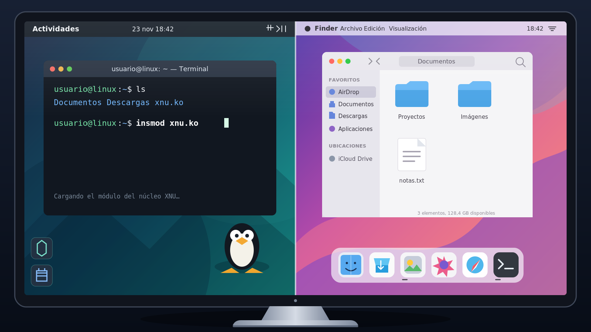

+++
title = "XNU dentro de Linux: un macOS sin máquina virtual"
slug = "20261123091040742"
date = "2026-11-23T09:10:45.330071+01:00"
[taxonomies]
autor = ["Víctor Manuel Jáquez Leal"]
tema = ["articulos"]
+++

¿Quién no ha querido dos sistemas operativos a la vez? Quien usa una
computadora con [Apple
Silicon](https://es.wikipedia.org/wiki/Apple_Silicon) y siente curiosidad por
Linux se ha hecho la pregunta inevitable: ¿y si pudiera usar macOS y Linux al
mismo tiempo, sin reiniciar? La respuesta de manual es una [máquina
virtual](https://es.wikipedia.org/wiki/Máquina_virtual), con un
[hipervisor](https://es.wikipedia.org/wiki/Hipervisor) de por medio entre el
sistema invitado y el hardware. El 20 de noviembre de 2026 apareció una
respuesta distinta y bastante más atrevida: cargar el propio núcleo de macOS,
`XNU`, como un módulo del núcleo de Linux, sin hipervisor. El proyecto se llama
`xnulinux` y su autor es Heyang Zhou, conocido en GitHub como `losfair`.

## ¿Qué es XNU?

`XNU` es el [núcleo](https://es.wikipedia.org/wiki/Núcleo_(informática)) del
[sistema operativo](https://es.wikipedia.org/wiki/Sistema_operativo) macOS. Su
nombre es un chiste recursivo típico del mundo Unix: `X is Not Unix`, es decir,
X no es Unix. Se trata de un núcleo híbrido, pues combina el [micronúcleo
Mach](https://es.wikipedia.org/wiki/Mach_(núcleo)) con componentes de
[BSD](https://es.wikipedia.org/wiki/Berkeley_Software_Distribution) y un marco
para controladores llamado `I/O Kit`. Mach aporta las tareas, el paso de
mensajes entre procesos y la base de la memoria virtual; BSD aporta los
sistemas de archivos, la red y la capa
[POSIX](https://es.wikipedia.org/wiki/POSIX); e `I/O Kit` permite cargar y
descargar controladores sin reiniciar. Es la base de
[Darwin](https://es.wikipedia.org/wiki/Darwin_(sistema_operativo)), del que
derivan macOS, iOS y los demás sistemas de Apple.

Lo relevante para esta historia es que Apple publica el código fuente de `XNU`
con una licencia de software libre, la [Apple Public Source
License](https://es.wikipedia.org/wiki/Apple_Public_Source_License) (APSL).
Cualquiera puede descargarlo, estudiarlo y, con mucha paciencia, compilarlo.
Eso es justo lo que hace `xnulinux`.

## ¿Cómo funciona?

`xnulinux` toma las fuentes de `XNU` que publica Apple (la versión
`xnu-12377.121.6`), les aplica un conjunto de parches que agregan una nueva
capa de máquina llamada `LINUX64`, las compila para la [arquitectura
ARM](https://es.wikipedia.org/wiki/Arquitectura_ARM) de 64 bits y las empaqueta
como un [módulo cargable del
núcleo](https://en.wikipedia.org/wiki/Loadable_kernel_module): `xnu.ko`. Con el
comando `insmod xnu.ko`, el núcleo de Linux hospeda al núcleo de macOS: ambos
comparten la misma máquina física, sin hipervisor.

El `XNU` hospedado maneja directamente la [unidad central de
procesamiento](https://es.wikipedia.org/wiki/Unidad_central_de_procesamiento) y
la [unidad de gestión de
memoria](https://es.wikipedia.org/wiki/Unidad_de_gestión_de_memoria), de modo
que los procesos de macOS corren de forma nativa junto a los procesos de Linux
en los mismos procesadores. Linux le presta memoria, temporizadores, archivos,
red y acceso a la tarjeta gráfica mediante un módulo pequeño, `fki.ko`
(*foreign kernel interface*, interfaz de núcleo extranjero).

Cada CPU hospedada es un hilo del núcleo de Linux fijado a una CPU física:
`XNU` corre en él hasta que necesita algo del anfitrión (una operación de
entrada y salida, un temporizador, quedarse ocioso) y entonces le devuelve el
control. La memoria de `XNU` es un bloque contiguo que Linux aparta con su
asignador `CMA`, y los dos núcleos comparten la mitad del [espacio de
direcciones](https://es.wikipedia.org/wiki/Espacio_de_direcciones) destinada al
[espacio de usuario](https://es.wikipedia.org/wiki/Espacio_de_usuario), con
páginas de 4 KiB. Los dispositivos se simulan con extensiones del núcleo (los
`kexts`): un disco respaldado por un archivo de Linux, una pantalla que es un
`framebuffer`, teclado y ratón, una tarjeta de red y un puente hacia la GPU.
Para los gráficos, las llamadas a
[Metal](https://es.wikipedia.org/wiki/Metal_(API)) se convierten a
[Vulkan](https://en.wikipedia.org/wiki/Vulkan) con `metal2vulkan` y de ahí
llegan, vía el controlador Venus de Mesa, hasta la GPU real de Linux; sin GPU,
todo se dibuja con software.

## Resultados y límites

El resultado sorprende: en una Mac con Apple Silicon, dentro de una máquina
virtual de Linux arm64 con `krunkit`, `xnulinux` arranca un disco de macOS
27.2.1, creado con el instalador de Apple, hasta el escritorio completo
(Finder, Dock, Safari, Chrome) en 31 a 48 segundos, contra los 49 segundos que
tarda una máquina virtual oficial de macOS en la misma Mac. Una prueba de
estrés de 30 minutos, abriendo y cerrando Safari, Notas, Calculadora y TextEdit,
terminó sin pánico del núcleo. El sistema puede correr como un servicio de
`systemd` que se reinicia solo si el núcleo hospedado falla.

Conviene leer la letra pequeña. La demostración todavía vive dentro de una
máquina virtual de Linux, no en hardware desnudo, y exige [autenticación de
punteros](https://en.wikipedia.org/wiki/Return-oriented_programming#Pointer_Authentication_Codes_(PAC))
(PAC), páginas de 4 KiB y al menos 16 GB de memoria, de los cuales 8 quedan
reservados para el núcleo hospedado. El repositorio no distribuye ningún
binario de Apple: cada quien debe aportar su propia instalación de macOS 27, y
hubo que desactivar o relajar varias protecciones, como `AMFI` y `SIP`, además
de integrar el `cryptex` al volumen del sistema. El acceso a memoria también es
más lento que en una máquina virtual nativa, por las páginas de 4 KiB frente a
las de 16 KiB habituales en macOS. Para el uso diario, una máquina virtual
sigue siendo la opción sensata; `xnulinux` es, por ahora, un experimento
brillante.

## La frontera de las licencias

Un detalle que gustará a quienes siguen los debates de licencias es el cuidado
con que el proyecto separa sus partes. El lado Linux (`fki.ko` y compañía) se
publica con [GPL](https://es.wikipedia.org/wiki/GNU_General_Public_License)
2.0; el lado `XNU` (`xnu.ko`, los parches y los `kexts`) con APSL 2.0; y ambos
solo se tocan en la interfaz `fki`. El módulo `xnu.ko` se declara como no GPL
y mancha el núcleo (el famoso *tainted kernel*), igual que hace
[ZFS](https://es.wikipedia.org/wiki/ZFS). Es un ejemplo poco común de cómo dos
regímenes de licencia conviven dentro del mismo núcleo.

## ¿Quién es Heyang Zhou?

Heyang Zhou es ingeniero de sistemas e infraestructura de datos. En GitHub es
`losfair`, y su perfil resume la trayectoria: cofundador de `AFK-surf`, la
organización que publica `xnulinux`, y antes ingeniero en Deno Land, la empresa
detrás del entorno de ejecución
[Deno](https://es.wikipedia.org/wiki/Deno_(software)), además de pasar por
Vercel y ByteDance. Vive en San Francisco y es autor de proyectos como
[`mvsqlite`](https://github.com/losfair/mvsqlite), una versión distribuida de
[SQLite](https://es.wikipedia.org/wiki/SQLite) sobre
[`FoundationDB`](https://en.wikipedia.org/wiki/FoundationDB). No se trata de un
recién llegado: es alguien con años de experiencia en sistemas, bases de datos
y tiempos de ejecución, que se permitió un experimento de esos que parecen
imposibles.

## En resumen

`xnulinux` no reemplaza a las máquinas virtuales ni es un camino práctico para
usar macOS hoy. Su valor está en lo que demuestra: que el núcleo de Linux es lo
bastante flexible para hospedar otro núcleo completo, y que el código abierto
de `XNU` hace posibles experimentos así. La discusión en
[Hacker News](https://news.ycombinator.com/item?id=50607261) combina asombro y
escepticismo, como corresponde a una idea tan audaz. Si te gustan los sistemas
operativos, vale la pena leer el repositorio aunque nunca lo vayas a ejecutar.

## Referencias

- [Repositorio de `xnulinux`](https://github.com/AFK-surf/xnulinux)
- [Fuentes de `XNU` publicadas por
  Apple](https://github.com/apple-oss-distributions/xnu)
- [XNU en Wikipedia](https://es.wikipedia.org/wiki/XNU)
- [Perfil de Heyang Zhou en GitHub](https://github.com/losfair)
- [Discusión de `xnulinux` en Hacker
  News](https://news.ycombinator.com/item?id=50607261)

<!-- Imagen sugerida: una pantalla dividida en dos mitades. A la izquierda, un
escritorio de Linux con una terminal que muestra el comando `insmod xnu.ko`;
a la derecha, el escritorio de macOS con el Dock y el Finder, como si ambos
sistemas compartieran la misma pantalla y la misma máquina. -->
